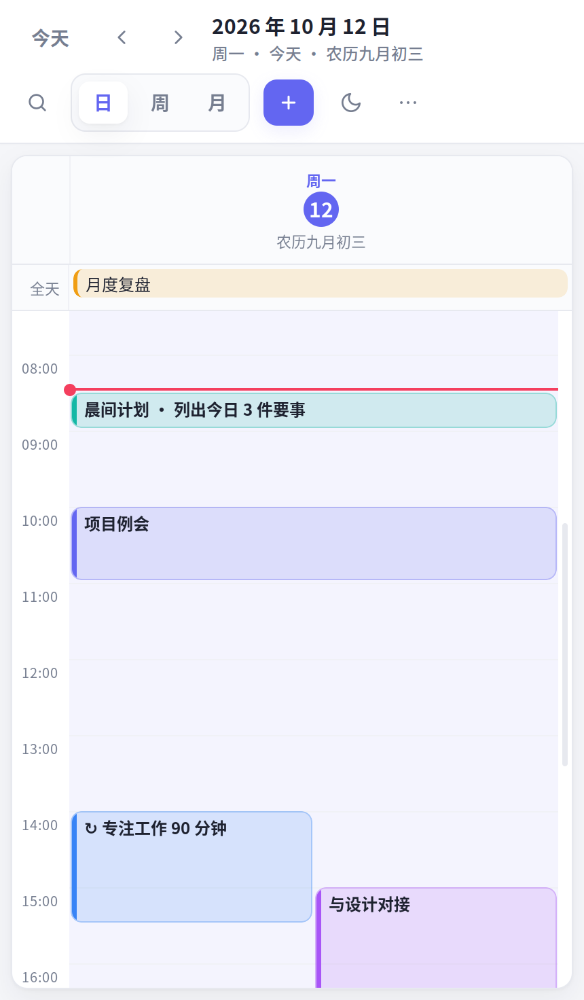
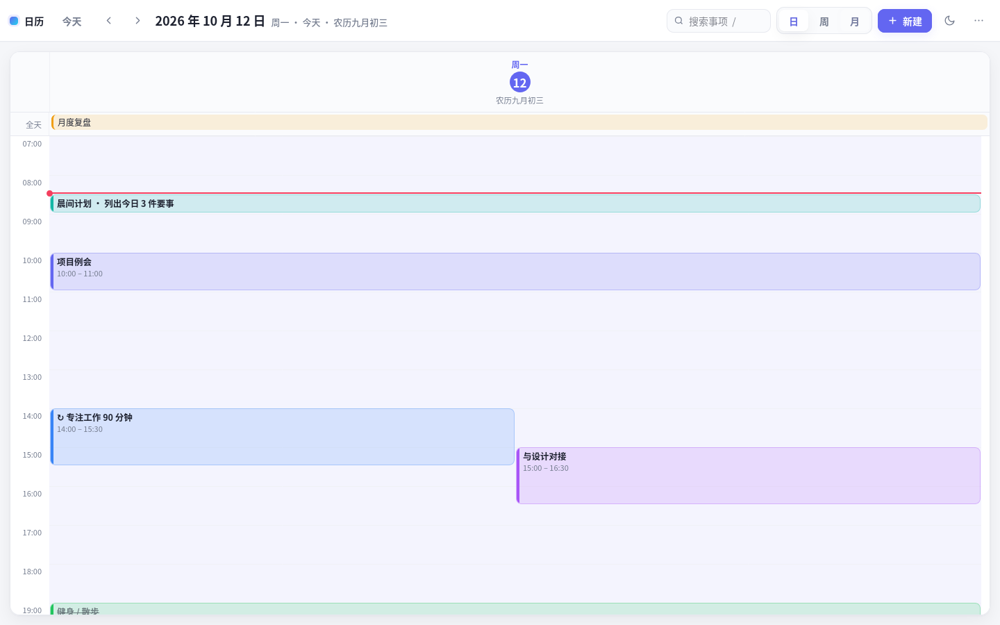
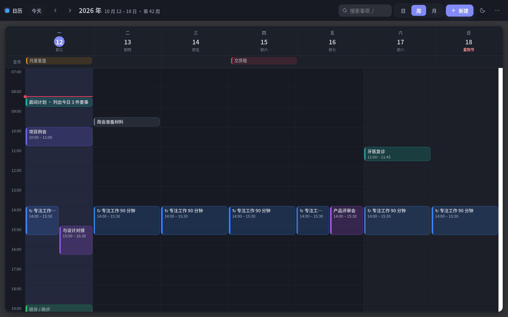

# 日历 · 本机小窗口应用

一个装在**原生小窗口**里的本地日历：不需要浏览器、没有标签页、没有网络请求和账号。
界面用系统自带的 GTK + WebKit 显示，事项存成本机 JSON 文件，内置**农历**与**工作日 / 节假日（含调休）**。


| 窗口·日视图 | 窗口·周视图（议程） |
| --- | --- |
|  |  |

把窗口拉宽后会切换成传统日历布局：

| 日视图 | 周视图（深色） | 新建事项 |
| --- | --- | --- |
|  |  |  |

**目录**：[安装](#一安装) · [卸载](#二卸载) · [环境与系统适配](#三环境与系统适配) · [怎么用](#四怎么用) · [农历与节假日](#五农历与工作日--节假日) · [数据在哪里](#六数据在哪里) · [文件说明](#七文件说明) · [自测](#八自测) · [常见问题](#九常见问题)

---

## 一、安装

### 1. 前置条件

程序是**绿色**的：整个 `calendar/` 目录拷到哪都能跑，不需要编译、不需要 root、不写系统目录（除了创建两个快捷方式文件）。
只要满足下面两点就能跑（Ubuntu 桌面版默认就满足）：

| 需要 | 说明 | 检查命令 |
| --- | --- | --- |
| Python 3.7+ | 系统自带 | `python3 --version` |
| GTK3 + WebKit2 组件 | Ubuntu 桌面版自带（GNOME 依赖它们） | `python3 -c "import gi; gi.require_version('WebKit2','4.0')"` |

缺组件时的表现和补装方法见 [三、环境与系统适配](#三环境与系统适配)——**即使缺 GUI 组件也不会用不了**，会自动退回浏览器版。

### 2. 一键安装（创建桌面图标 + 应用菜单项）

```bash
cd ~/Desktop/Deepseek_project/calendar
./install.sh
```

`install.sh` 只做这几件事（都是用户级操作，不需要 sudo）：

1. 给 `calendar.sh`、`calendar_app.py` 加上可执行权限；
2. 生成启动项 `local-calendar.desktop`，写入两个位置：
   - `~/.local/share/applications/` —— 出现在「显示应用程序」里
   - 桌面目录（`xdg-user-dir DESKTOP`，通常是 `~/Desktop/`）—— 双击即开
3. 用 `gio set … metadata::trusted true` 把桌面图标标记为「可信」；
4. 刷新桌面数据库（`update-desktop-database`）。

> 第 3、4 步的工具若不存在会被自动跳过，不影响安装结果。

**验证安装成功**：在「显示应用程序」里搜 **日历**，或看桌面是否出现「日历」图标；也可以命令行检查：

```bash
ls -l ~/.local/share/applications/local-calendar.desktop
grep '^Exec' ~/.local/share/applications/local-calendar.desktop
# 期望看到：Exec=python3 /…/calendar/calendar_app.py
```

**如果桌面图标提示「不受信任」/ 双击没反应**：右键图标 → 「允许启动」；或手动执行一次：

```bash
gio set ~/Desktop/local-calendar.desktop metadata::trusted true
```

### 3. 免安装直接运行（不改动系统任何文件）

```bash
python3 calendar_app.py            # 直接开小窗口
python3 calendar_app.py --size 500x900   # 指定初始尺寸
python3 calendar_app.py --view day       # 打开就是日视图
./calendar.sh                      # 用浏览器打开
```

只想先试用、不想留任何痕迹的话，用这种方式即可；数据仍然保存在本机 JSON 文件里（见 [六、数据在哪里](#六数据在哪里)）。

---

## 二、卸载

卸载分三层，可按需选择（**都不需要 sudo**）：

### 1. 只删快捷方式（保留程序和数据）

```bash
cd ~/Desktop/Deepseek_project/calendar
./install.sh --uninstall
```

会删除 `~/.local/share/applications/local-calendar.desktop` 和桌面上的 `local-calendar.desktop`，并刷新桌面数据库。
之后仍可用 `python3 calendar_app.py` 或 `./calendar.sh` 启动。

### 2. 删掉程序本体

```bash
rm -rf ~/Desktop/Deepseek_project/calendar
```

程序是纯绿色文件，删目录即卸载完毕。若之前用浏览器版起过后台服务，先停掉：

```bash
cd ~/Desktop/Deepseek_project/calendar && ./calendar.sh --stop    # 删除目录前执行
```

### 3. 删掉个人数据与配置（不可恢复，建议先导出备份）

```bash
rm -rf ~/.local/share/local-calendar     # 事项数据 calendar.json 及其 .bak
rm -rf ~/.config/local-calendar          # 窗口大小/位置记录
```

### 4. 检查是否清理干净

```bash
ls ~/.local/share/applications/local-calendar.desktop ~/Desktop/local-calendar.desktop 2>&1
ls -d ~/.local/share/local-calendar ~/.config/local-calendar 2>&1
# 全部显示 "No such file or directory" 即已清理干净
```

> 用浏览器版时，页面会在浏览器里留一份 localStorage 镜像（对应站点 `http://127.0.0.1:8765`）。
> 介意的话可在浏览器设置里清除该站点数据；**事项的真正数据是上面的 `calendar.json`**，清不清浏览器数据都不影响窗口版。

---

## 三、环境与系统适配

### 1. 已验证的运行环境（本机实测）

| 项目 | 版本 |
| --- | --- |
| 操作系统 | Ubuntu 20.04.6 LTS (focal) |
| 内核 | 5.15.0-139-generic |
| 桌面环境 | GNOME Shell 3.36.9，**X11 会话** |
| Python | 3.8（代码要求 3.7+） |
| PyGObject | 3.36.0 |
| GTK | 3.24.20（`gir1.2-gtk-3.0`） |
| WebKitGTK | 2.38.6（`gir1.2-webkit2-4.0` + `libwebkit2gtk-4.0-37`） |
| 中文字体 | Noto Sans CJK SC（已安装） |
| 浏览器（浏览器版/自测用） | Firefox 136 |

### 2. 依赖清单

| 依赖 | 用途 | 是否必需 |
| --- | --- | --- |
| `python3` (≥3.7) | 运行窗口应用/本地服务 | **必需** |
| `python3-gi`（PyGObject） | Python 调 GTK/WebKit | 窗口版必需 |
| `gir1.2-gtk-3.0` + `libgtk-3-0` | 原生窗口 | 窗口版必需 |
| `gir1.2-webkit2-4.0` + `libwebkit2gtk-4.0-37` | 渲染界面 | 窗口版必需 |
| 中文字体（`fonts-noto-cjk` 等） | 界面文字显示 | 建议 |
| 任意现代浏览器 | 浏览器版 | 可选 |
| Firefox 或 Chromium | 仅运行自测脚本 `tests/run.sh` | 可选 |

Debian / Ubuntu 一次性补齐：

```bash
sudo apt install python3-gi gir1.2-gtk-3.0 gir1.2-webkit2-4.0 fonts-noto-cjk
```

### 3. 缺东西时的行为（都会自动降级，不会白屏卡死）

| 情况 | 表现 |
| --- | --- |
| 没有 `python3` | `calendar.sh` 改用 `file://` 直接打开页面，功能基本一致 |
| 缺 GTK/WebKit 组件 | `calendar_app.py` 自动改用浏览器模式打开 |
| 没有 GPU 直通（虚拟机/容器） | 自动关闭 WebKit 加速合成、改用软件渲染 |
| 家目录只读 / XDG 目录不可写 | WebKit 数据目录与数据文件自动退到临时目录，并在窗口内给出提示 |
| 页面 8 秒内没加载出来 | 窗口内显示可读的错误说明（含排查提示），而不是一直白屏 |

### 4. 其他发行版 / 桌面环境

脚本只用 `bash` + `python3` + XDG 标准目录，原则上任何 Linux 发行版都能用，只是包名不同：

| 发行版 | 安装 GUI 依赖 | 备注 |
| --- | --- | --- |
| Debian / Ubuntu | `sudo apt install python3-gi gir1.2-gtk-3.0 gir1.2-webkit2-4.0` | **本机实测** |
| Fedora | `sudo dnf search webkit2gtk` 后安装对应的包（通常是 `python3-gobject` + `gtk3` + `webkit2gtk4.0`） | 未实测，以仓库查询为准 |
| Arch / Manjaro | `pacman -Ss webkit2gtk` 后安装对应的包（通常是 `python-gobject` + `gtk3` + WebKitGTK） | 未实测，仓库里多为 4.1 / 6.0，见下方说明 |

判断依赖是否就绪，用这一条命令最直接（无输出即正常）：

```bash
python3 -c "import gi; gi.require_version('Gtk','3.0'); gi.require_version('WebKit2','4.0')"
```

**关于 WebKit 版本**：本程序使用 **WebKit2 的 4.0 typelib**。较新的发行版（例如 Ubuntu 24.04）默认只提供 4.1 / 6.0，此时窗口版会**自动退回浏览器版**，功能不受影响。若想要窗口版，可尝试补装 4.0 运行时；或把 `calendar_app.py` 里的
`gi.require_version("WebKit2", "4.0")` 改成 `"4.1"`（4.1 与 4.0 的 API 兼容，本项目用到的接口一致）。

**关于显示服务器**：在 **X11** 下已完整验证；**Wayland 未实测**——窗口本身可正常显示，但 GTK 的窗口类名（`set_wmclass`）只在 X11 生效，Wayland 下任务栏图标可能显示为默认图标。

### 5. 中文字体

界面依赖系统 CJK 字体。若农历、日期显示成方块，安装中文字体即可：

```bash
sudo apt install fonts-noto-cjk     # 或 fonts-wqy-zenhei
```

### 6. 未适配的平台

**macOS / Windows 未适配**：脚本使用了 Linux 的 XDG 目录约定、GTK3 + WebKit2GTK 与 `xdg-open`/`gio` 等命令。
（浏览器版的核心页面 `index.html` 是纯前端、跨平台，理论上可直接用浏览器打开使用；但数据文件读写、快捷键、桌面集成这些是按 Linux 做的。）

---

## 四、怎么用

| 操作 | 说明 |
| --- | --- |
| 新建事项 | 顶栏 **＋**，或**单击日历空白时间格**（自动带上该时间），或按 <kbd>N</kbd> |
| 小窗口里新建 | 月视图把鼠标移到日期格 → 右上角 **＋**；点空白处 = 当天全天事项 |
| 修改 | 单击事项块 / 色条 / 议程行 |
| 拖动改时间 | 直接**拖动**事项到别的时间或日期（重复事项不可拖） |
| 全天事项 | 新建时勾「全天」，显示在顶部「全天」栏 |
| 重复事项 | 选「每天 / 每周 / 每月」，右侧可填重复结束日期（留空 = 一直重复） |
| 删除重复中的某一次 | 打开那一次 → 删除（只跳过这一次，系列保留）；打开系列首次 → 删除整个系列 |
| 搜索 | 点 🔍 或按 <kbd>/</kbd>（小窗口里搜索框是折叠的） |
| 完成标记 | 编辑弹窗勾「已完成」，事项变灰划线 |
| 主题 | 点 🌙 在 **跟随系统 → 浅色 → 深色** 之间循环 |
| 看农历 / 节假日 | 每个日期格、周表头、议程行、弹窗日期下方都会显示 |

**快捷键**

| 快捷键 | 作用 |
| --- | --- |
| <kbd>N</kbd> / <kbd>D</kbd> / <kbd>W</kbd> / <kbd>M</kbd> / <kbd>T</kbd> | 新建 / 日 / 周 / 月 / 回到今天 |
| <kbd>←</kbd> <kbd>→</kbd> | 上一 / 下一时间段 |
| <kbd>/</kbd> | 搜索；<kbd>Esc</kbd> 关闭弹窗、收起搜索 |
| <kbd>Ctrl</kbd>+<kbd>S</kbd> | 弹窗内保存 |
| <kbd>Ctrl</kbd>+<kbd>Q</kbd> 或 <kbd>Ctrl</kbd>+<kbd>W</kbd> | 关闭窗口 |
| <kbd>Ctrl</kbd>+<kbd>R</kbd> | 重新载入界面 |
| <kbd>Ctrl</kbd>+<kbd>+</kbd> / <kbd>-</kbd> / <kbd>0</kbd> | 放大 / 缩小 / 恢复 |
| <kbd>F11</kbd> | 最大化切换 |

窗口**大小和位置会被记住**（存在 `~/.config/local-calendar/window.json`）。
窄窗口（小于 620px）自动换一套紧凑布局：月视图用色点、周视图变成按天分组的议程列表。

---

## 五、农历与工作日 / 节假日

**农历**：内置 1900–2100 年的完整农历算法（含闰月），无需联网。
月视图每个格子在日期下方显示农历（初一显示月份名，如「九月」），传统节日会直接显示名称：
春节、元宵节、龙抬头、端午节、七夕节、中元节、中秋节、重阳节、腊八节、小年、除夕。

**工作日 / 节假日**：数据来自中国政府网公布的国务院办公厅通知原文，

| 年份 | 文号 | 通知原文 |
| --- | --- | --- |
| 2024 | 国办发明电〔2023〕7号 | [gov.cn](https://www.gov.cn/gongbao/2023/issue_10806/202311/content_6913823.html) |
| 2025 | 国办发明电〔2024〕12号 | [gov.cn](http://big5.www.gov.cn/gate/big5/www.gov.cn/gongbao/2024/issue_11726/202411/content_6989767.html) |
| 2026 | 国办发明电〔2025〕7号 | [gov.cn](https://www.gov.cn/zhengce/content/202511/content_7047090.htm) |

- **休**（红底徽标）= 法定放假，含调休连休；格子淡红底、日期数字变红。
- **班**（灰底徽标）= 调休上班的周末；该格子**不会**按周末着色，一眼能看出这周要上班。
- 点击 `⋯` 菜单可以看到当前数据的年份范围和对应文号。

**每年新通知发布后怎么更新**（国务院一般 11 月发布次年安排）：

```bash
# 方式一：改 tools/make-holidays.py 里的 YEARS，重新生成
vim tools/make-holidays.py     # 按新通知加一组 ranges / work
python3 tools/make-holidays.py
python3 tools/make-holidays.py --js   # 把输出的内置表同步进 index.html（可选）

# 方式二：直接编辑 holidays.json（同目录存在时，以该文件为准，可覆盖内置表）
```

没有数据的年份不会出错：退回「周六周日休息、其余上班」，农历照常显示。

---

## 六、数据在哪里

- 事项保存为普通 JSON 文件：**`~/.local/share/local-calendar/calendar.json`**
- 每次覆盖写入前会保留上一版为 `calendar.json.bak`；写入采用「先写临时文件再原子替换」，中途断电不会写坏。
- 用文本编辑器、脚本、同步盘都能直接处理这个文件；也可以走 UI 的 `⋯ → 导出备份 / 导入备份`。
- 浏览器版和窗口版**读写同一个文件**，两边内容一致（但**不建议同时开着两边改**，后保存的会覆盖先保存的）。
- 应用内部只监听 `127.0.0.1`，外部网络无法访问；写接口只接受来自本机页面的请求。

---

## 七、文件说明

```
calendar/
├── calendar_app.py       小窗口应用（GTK3 + WebKit2GTK），默认入口
├── index.html            日历界面本体：单文件，含农历算法与节假日内置表
├── holidays.json         节假日数据（放假 / 调休上班），可自行编辑覆盖
├── serve.py              本地微型服务：静态页 + 数据读写 API + 健康检查
├── calendar.sh           命令行启动器（浏览器版 / --window 窗口版 / --stop）
├── install.sh            安装 / 卸载桌面快捷方式（./install.sh --uninstall）
├── icon.svg              应用图标
├── tools/make-holidays.py  依据官方通知生成 holidays.json 与内置表
├── preview/              界面预览图
└── tests/                自测（./tests/run.sh，结果见 tests/result-*.png）
```

运行时的隐藏小文件（可随手删除）：`.port` 端口记录、`.server.log` 日志、`.server.pid` 进程号。

---

## 八、自测

```bash
./tests/run.sh            # 全部三套，共 125 项断言
./tests/run.sh logic      # 农历换算 / 节假日判定 / 重复规则 / 排版 / 增删改
./tests/run.sh compact    # 小窗口布局：议程周视图、月视图色点、农历与休班标记
./tests/run.sh storage    # 界面操作 → 真的写进 JSON 文件；节假日数据一致性
```

自测需要一个无头浏览器（Firefox 或 Chromium）。农历部分用官方通知里给出的农历日期做锚点
（如 2026 年通知写明「2月15日农历腊月二十八」「2月23日正月初七」），以及 2020/2023/2025 的闰月等已知事实交叉验证。

---

## 九、常见问题

**双击桌面图标提示「不受信任」？** 见 [安装](#一安装) 一节，右键选择「允许启动」即可。

**装完在应用菜单里搜不到？** 执行 `update-desktop-database ~/.local/share/applications`，或注销重新登录一次。

**窗口太大 / 太小？** 拖边缘调整即可，会自动记住；也可用 `--size 380x700` 指定初始尺寸。

**农历显示成方块？** 缺中文字体，见 [三、环境与系统适配](#三环境与系统适配) 第 5 节。

**节假日数据会过期吗？** 已内置 2024–2026；2027 年的安排发布后按第五节的办法更新即可，
没更新也只是那一年不显示「休 / 班」，其他功能不受影响。

**在虚拟机 / 远程桌面里能用吗？** 可以，程序会自动改用软件渲染并处理只读目录，见第三节的降级表。

**想彻底卸载？** 见 [二、卸载](#二卸载)。
