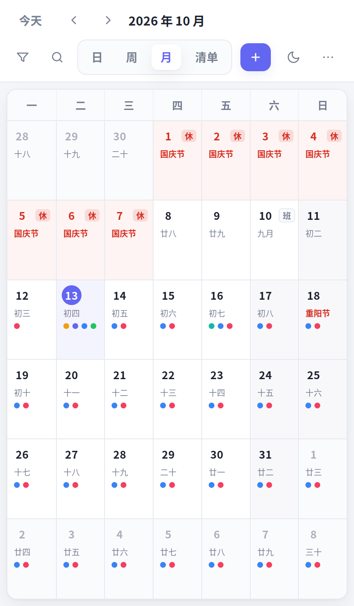

# 日历 1.0

一个装在**原生小窗口**里的本地日历：不需要浏览器、没有标签页、没有网络请求和账号，完全离线运行。
事项存成本机 JSON 文件，内置农历与工作日/节假日数据。

**1.0 在原有「日 / 周 / 月 + 农历 + 工作日节假日」之上新增六项能力：**

| 新增 | 一句话说明 |
| --- | --- |
| **待办清单模式** | 按 逾期/今天/明天/本周内/以后/已完成 分组，勾选完成，带完成率进度条 |
| **快速添加语法** | 一行文字 `明天 10:00 项目例会 #工作 !高 45min` 直接建事项，带实时解析预览 |
| **标签分类与筛选** | 多标签 + 按标签/颜色/状态筛选，搜索支持 `#标签`，筛选条件显式可见可单独取消 |
| **统计面板** | 本周/本月/全部：完成率、逾期数、总时长、按标签时长、颜色与优先级分布、每日柱状图 |
| **打印 / 导出** | 周计划表、月计划表、待办清单三种排版；系统打印、**直接导出 PDF**、另存自包含 HTML |
| **撤销与版本历史** | Ctrl+Z/Y 撤销重做（50 步）；每次覆盖保存前自动快照，可在界面里选任意版本恢复 |


| 待办清单 | 快速添加 | 统计面板 |
| --- | --- | --- |
|  |  |  |

| 打印预览 | 版本历史 | 窗口·月视图 |
| --- | --- | --- |
|  |  |  |

---

## 立刻开始

```bash
cd ~/Desktop/Deepseek_project/calendar_1.0
./install.sh          # 创建桌面图标 + 应用菜单项（不需要 sudo）
```

之后在应用菜单搜「**日历 1.0**」，或双击桌面图标。

```bash
python3 calendar_app.py --view list      # 打开就是待办清单
./calendar.sh                            # 或用浏览器打开
```

## 文档

| 文档 | 内容 |
| --- | --- |
| **[使用说明书.md](使用说明书.md)** | 安装卸载、四个视图、六项新功能详解、快速添加语法全表、统计口径、打印导出、快捷键、数据位置、**未能满足与存在边界的地方** |
| **[源码说明.md](源码说明.md)** | 架构与数据流、数据模型、农历算法、节假日判定、重复展开、解析器设计、渲染与布局、打印桥、备份策略、测试体系、**二次开发指引** |
| 本文件 | 项目概览与快速上手 |


## 目录结构

```
calendar_1.0/
├── calendar_app.py        小窗口应用（GTK3 + WebKit2GTK），默认入口
├── index.html             界面本体：单文件，含农历算法与节假日内置表
├── holidays.json          节假日数据（放假 / 调休上班），可自行编辑覆盖
├── serve.py               本地微型服务：静态页 + 数据 API + 版本历史
├── calendar.sh            命令行启动器（浏览器版 / --window / --stop）
├── install.sh             安装或卸载桌面快捷方式（--uninstall）
├── icon.svg               应用图标
├── tools/make-holidays.py 依据官方通知生成节假日数据
├── preview/               界面预览图
├── 使用说明书.md
└── 源码说明.md
```

## 运行环境

已验证：Ubuntu 20.04.6 LTS · GNOME 3.36 · X11 · Python 3.8 · PyGObject 3.36 · GTK 3.24.20 · WebKitGTK 2.38.6。

```bash
sudo apt install python3-gi gir1.2-gtk-3.0 gir1.2-webkit2-4.0 fonts-noto-cjk
```

缺 GUI 组件会自动退回浏览器版；无 GPU 直通（虚拟机/容器）自动改用软件渲染；
家目录只读时数据目录自动退到临时目录。详见使用说明书第十三节。
