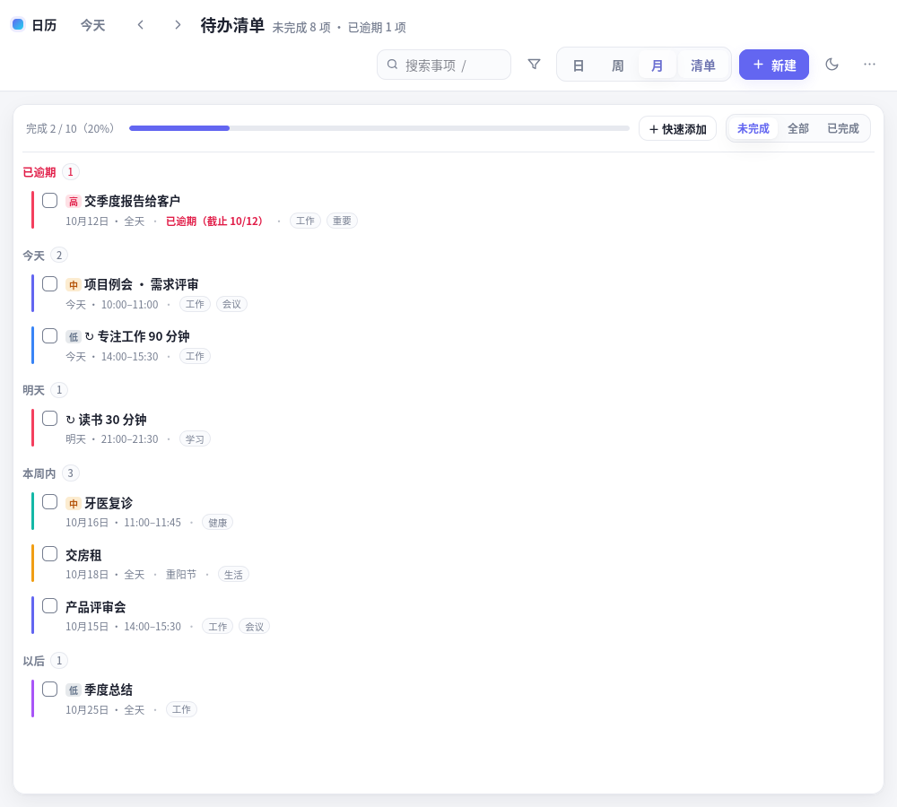
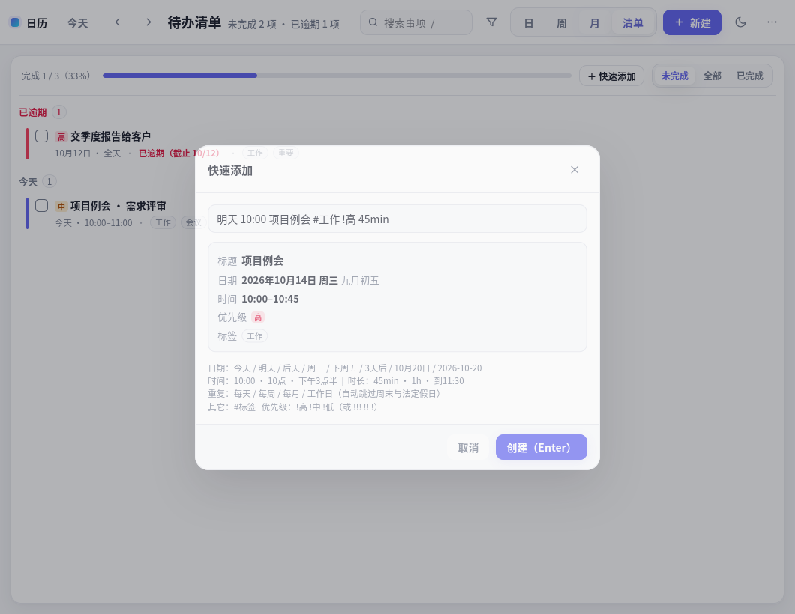

# 日历 1.0 · 使用说明书

> 本手册对应 `calendar_1.0/` 目录。它与之前的 `calendar/` **完全独立**：各自的应用图标、各自的数据文件、各自的端口，可以同时安装、同时运行，互不影响。
>
> 1.0 在原有「日 / 周 / 月 + 农历 + 工作日节假日」的基础上，新增了六项能力：
> **待办清单模式 · 快速添加语法 · 标签分类与筛选 · 统计面板 · 打印/导出计划表 · 撤销与版本历史**。


---

## 目录

1. [安装与卸载](#一安装与卸载)
2. [界面总览](#二界面总览)
3. [基础用法](#三基础用法)
4. [待办清单模式](#四待办清单模式)
5. [快速添加语法](#五快速添加语法)
6. [标签与筛选](#六标签与筛选)
7. [统计面板](#七统计面板)
8. [打印与导出](#八打印与导出)
9. [撤销与版本历史](#九撤销与版本历史)
10. [农历与工作日/节假日](#十农历与工作日节假日)
11. [数据与文件位置](#十一数据与文件位置)
12. [快捷键总表](#十二快捷键总表)
13. [环境与系统适配](#十三环境与系统适配)
14. [自测](#十四自测)
15. [未能满足或存在边界的地方](#十五未能满足或存在边界的地方)
16. [常见问题](#十六常见问题)

---

## 一、安装与卸载

### 前置条件

程序是绿色的：整个 `calendar_1.0/` 目录拷到哪都能跑，不需要编译、不需要 root。

| 需要 | 说明 | 检查命令 |
| --- | --- | --- |
| Python 3.7+ | 系统自带 | `python3 --version` |
| GTK3 + WebKit2 组件 | Ubuntu 桌面版自带 | `python3 -c "import gi; gi.require_version('Gtk','3.0'); gi.require_version('WebKit2','4.0')"`（无输出即正常） |

即使缺 GUI 组件也不会用不了：窗口版会自动退回浏览器版。

### 安装（创建桌面图标 + 应用菜单项）

```bash
cd ~/Desktop/Deepseek_project/calendar_1.0
./install.sh
```

`install.sh` 只做四件事（全部用户级，不需要 sudo）：

1. 给 `calendar.sh`、`calendar_app.py` 加可执行权限；
2. 生成启动项 `local-calendar-1.0.desktop`，写入 `~/.local/share/applications/` 与桌面目录；
3. 用 `gio set … metadata::trusted true` 把桌面图标标记为可信（GNOME 需要，工具缺失则跳过）；
4. 刷新桌面数据库。

安装后：应用菜单里搜「**日历 1.0**」，或双击桌面上的图标。

**验证**：

```bash
ls -l ~/.local/share/applications/local-calendar-1.0.desktop
grep '^Exec' ~/.local/share/applications/local-calendar-1.0.desktop
```

### 免安装直接运行

```bash
python3 calendar_app.py                  # 小窗口
python3 calendar_app.py --view list      # 直接进待办清单
python3 calendar_app.py --size 500x900   # 指定初始尺寸
./calendar.sh                            # 用浏览器打开
```

### 卸载

```bash
./install.sh --uninstall                 # 只删快捷方式
rm -rf ~/Desktop/Deepseek_project/calendar_1.0          # 删程序本体
rm -rf ~/.local/share/local-calendar/calendar-1.0.json* # 删数据（含 .bak）
rm -rf ~/.local/share/local-calendar/backups            # 删版本历史
rm -rf ~/.config/local-calendar-1.0                     # 删窗口尺寸记录
```

> 注意：版本历史与数据放在**同一个目录** `~/.local/share/local-calendar/` 下（数据文件叫 `calendar-1.0.json`，备份在 `backups/` 子目录）。如果你同时装了旧版 `calendar/`，旧版的数据文件是 `calendar.json`，删除时别误删。

---

## 二、界面总览

```
┌──────────────────────────────────────────────────────────────┐
│ 日历 1.0  今天 ‹ ›  2026 年 10 月    [搜索] [筛选] 日周月清单 ＋新建 🌙 ⋯ │
├──────────────────────────────────────────────────────────────┤
│ （有筛选时）筛选中：#工作 ×  清除全部                          │
├──────────────────────────────────────────────────────────────┤
│                                                              │
│                        视图区域                               │
│                                                              │
└──────────────────────────────────────────────────────────────┘
```

| 元素 | 作用 |
| --- | --- |
| 今天 / ‹ › | 回到今天、上一页、下一页（日↔天，周↔7 天，月↔月，清单↔不翻页） |
| 标题 | 显示当前范围；日视图还带农历、节日、休/班 |
| 搜索框 | 关键字搜索（支持 `#标签`），小窗口里折叠成 🔍 图标 |
| **筛选（漏斗）** | 按标签 / 颜色 / 状态筛选，1.0 新增 |
| 日 周 月 **清单** | 四个视图切换，`清单` 是 1.0 新增的待办模式 |
| ＋新建 | 打完整的编辑窗口（含标签、优先级、截止日、重复） |
| 🌙 | 主题：跟随系统 → 浅色 → 深色 |
| ⋯ | 快速添加 / 统计 / 打印 / 撤销 / 版本历史 / 导入导出 / 清空 |

---

## 三、基础用法

| 操作 | 怎么做 |
| --- | --- |
| 新建 | 点 **＋新建**；或**单击日历空白时间格**（自动带上该时间）；或按 <kbd>N</kbd> |
| 新建（月视图） | 鼠标移到日期格 → 右上角 **＋**；点格子空白处 = 当天全天事项 |
| 修改 | 单击事项块 / 色条 / 议程行 / 清单条目 |
| 拖动改时间 | 直接拖动事项块到别的时间或日期（重复事项不可拖，避免误改整个系列） |
| 全天事项 | 编辑窗口勾「全天」，显示在顶部「全天」栏 |
| 重复 | 不重复 / 每天 / 每周 / 每月 + 可填重复结束日期；再勾「跳过周末和法定假日」即变成「工作日」语义 |
| 删除重复中的某一次 | 打开那一次 → 删除（只跳过这一次，系列保留）；打开系列首次 → 删除整个系列 |
| 完成 | 编辑窗口勾「已完成」，或在清单视图点左侧方框 |
| 搜索 | 点 🔍 或按 <kbd>/</kbd>；支持 `#标签` 语法 |
| 主题 | 点 🌙 循环切换 |

---

## 四、待办清单模式

按 <kbd>L</kbd>、点顶栏「**清单**」，或启动时用 `--view list`。



**分组规则**（按截止日自动分组，截止日默认等于事项日期）：

| 分组 | 含义 |
| --- | --- |
| **已逾期** | 截止日早于今天且未完成（标题显示为红色） |
| **今天** / **明天** | 截止日是今天 / 明天 |
| **本周内** | 截止日在本周剩余天数内（周一起算） |
| **以后** | 更远的将来 |
| **已完成** | 勾选完成的（默认隐藏） |

**组内排序**：优先级高的在前，其次按时间（全天事项排前面）。

**要点**：

- 重复事项只显示**下一次出现**，不会把未来几十次都列出来；
- 勾选框即点即生效，并会记入撤销栈（<kbd>Ctrl</kbd>+<kbd>Z</kbd> 可撤回）；
- 顶部进度条显示「完成 N / 总数（百分比）」，分母随**当前筛选**变化；
- 状态切换：**未完成 / 全部 / 已完成**（只影响清单视图）；
- 点条目上的**标签胶囊**即可把它加入筛选；
- 顶部有「＋ 快速添加」按钮，直接进入第五节的一行式添加。

---

## 五、快速添加语法

按 <kbd>Q</kbd>，或 ⋯ 菜单 →「快速添加」，或在清单视图点「＋ 快速添加」。



输入一行文字，下面**实时显示解析结果**（标题 / 日期 / 时间 / 优先级 / 标签），按 <kbd>Enter</kbd> 创建。<kbd>Esc</kbd> 取消。

| 类别 | 支持写法 | 例子 |
| --- | --- | --- |
| 日期 | 今天、明天、后天、大后天 | `明天 10:00 开会` |
| | N 天后 | `3天后 提交材料` |
| | 周X / 星期X（最近的，含今天） | `周五 交房租` |
| | 本周X / 下周X / 下下周X | `下周一 9点 周会` |
| | M月D日（已过则算明年） | `10月20日 季度总结` |
| | M-D、YYYY-MM-DD | `12-25 圣诞聚会`、`2026-11-05 体检` |
| 时间 | HH:MM、H点、H点半 | `14:00`、`10点`、`下午3点半` |
| | 时段前缀：凌晨 / 早上 / 上午 / 中午 / 下午 / 傍晚 / 晚上 | `晚上8点 看电影` |
| 时长 | Nmin / N分钟 / Nh / N小时 / 到 HH:MM | `45min`、`1h`、`到11:30` |
| 重复 | 每天 / 每周 / 每月 / 每周三 / 每月15日 / 工作日 | `工作日 9:00 站会` |
| 标签 | #标签（可多个） | `#工作 #会议` |
| 优先级 | !高 !中 !低（或 !!! !! !） | `!高`、`!!!` |

**实例**（左侧是输入，右侧是解析结果）：

| 输入 | 解析结果 |
| --- | --- |
| `明天 10:00 项目例会 #工作 !高 45min` | 10月14日 10:00–10:45 · 高 · #工作 ·「项目例会」 |
| `今天 下午3点半 与设计对接` | 今天 15:30–16:30 ·「与设计对接」 |
| `每周一 9:00 周会 !中` | 每周一 09:00–10:00 · 中 ·「周会」 |
| `每月15日 交房租` | 每月 15 日 · 全天 ·「交房租」 |
| `工作日 9:00 站会 #工作` | 每天 09:00–10:00 + **跳过周末与法定假日** · #工作 |
| `3天后 提交材料` | 三天后 · 全天 ·「提交材料」 |
| `12-25 圣诞聚会 晚上7点` | 12月25日 19:00–20:00 ·「圣诞聚会」 |
| `明天 开会 到 11:30` | 明天 10:30–11:30 ·「开会」（只写结束时间时，开始时间自动取前一小时） |

**规则与边界**：

- 只写「到 11:30」→ 开始时间 = 结束时间 − 1 小时；
- 只写开始时间不写时长 → 默认 1 小时；
- 没写时间 → 全天事项；
- **解析不出来的文字全部保留在标题里，绝不丢字**（解析器只"吃掉"它认得的部分）；
- 不支持「下个月第一个周一」「月底」「每双周」这类写法（见第十五节）。

---

## 六、标签与筛选

### 打标签

编辑窗口 → 「标签」输入框：输入后按 <kbd>Enter</kbd> 或逗号添加，标签上按 × 删除，退格可删最后一个。最多 8 个，每个最长 24 字符；输入时会出现已有标签的自动补全。

### 筛选

点顶栏的**漏斗图标**，面板里有三组条件（可叠加）：

| 条件 | 说明 |
| --- | --- |
| 标签 | 多选；多个标签之间是「**同时满足**」 |
| 颜色 | 8 色任选一个 |
| 状态 | 未完成 / 全部 / 已完成（作用于清单视图） |

筛选生效时：

- 顶栏漏斗图标高亮；
- 视图上方出现「**筛选中：** #工作 × · 颜色：玫红 × …… 清除全部」的横条，每个条件都能单独点掉——这样不会出现"东西怎么都不见了"；
- **日历视图、清单视图、统计面板、打印导出**都会遵循筛选条件。

### 搜索语法

搜索框里除了普通关键字（匹配标题、备注、标签），还支持 `#标签`：

```
#工作              只看带「工作」标签的
周报 #工作          同时包含「周报」和 #工作 的
```

多个条件用空格分隔，是「与」关系。

---

## 七、统计面板

按 <kbd>S</kbd>，或 ⋯ 菜单 →「统计面板」。


| 区块 | 内容 |
| --- | --- |
| 概览卡片 | 事项数、完成率（含进度）、已逾期未完成、定时事项总时长、全天事项数 |
| 每日分布 | 期间内每天的柱状图（今天用红色标出） |
| 标签 | 每个标签的条目数、总时长、完成率，横向条形图 |
| 颜色分布 | 各颜色条目数与占比 |
| 优先级 | 高 / 中 / 低 / 无 的数量与占比 |

时间段可选 **本周 / 本月 / 全部**。

**统计口径（重要）**：

- 重复事项按所选时间段内的**每次出现各计一次**（所以「每天 晨会」一周算 7 次）；
- 「总时长」只累加**定时事项**（结束−开始），全天事项只计数不计时长；
- 「全部」最多回溯 **两年**，避免无限重复事项展开过多；
- 若当前有筛选条件，统计只包含筛选后的事项，面板底部会给出提示。

---

## 八、打印与导出

按 <kbd>P</kbd>，或 ⋯ 菜单 →「打印 / 导出」。


预览窗口顶部可切换三种表格，并勾选是否**包含已完成事项**：

| 表格 | 内容 | 适合 |
| --- | --- | --- |
| **周计划** | 按天分段（周一…周日），每天列出时间 / 事项 / 标签 / 优先级，左侧方框可手写勾选 | 打印出来贴在桌上，一周一页 |
| **月计划** | 7×6 月历网格，每格显示日期、农历/休班、当天事项 | 整月概览、排计划 |
| **待办清单** | 按 逾期/今天/明天/本周内/以后/已完成 分组的清单，带手写方框 | 当周待办 |

三种表格都会带上日期范围、农历、节假日（休/班）、优先级和标签，页脚注明生成时间。

**三个导出动作**：

| 按钮 | 说明 |
| --- | --- |
| **打印** | 打开系统打印对话框：可打物理打印机，也可选「**打印到文件**」生成 PDF |
| **导出 PDF** | 不弹对话框，直接输出 PDF（内部用 GTK 内置的 "Print to File" 后端，**不需要装任何额外软件**） |
| **另存为 HTML** | 存成一个自包含的 HTML 文件（样式内嵌），双击即可打开或再打印，方便发给别人或长期存档 |

**命令行导出**（不打开窗口交互，适合脚本 / 定时任务）：

```bash
python3 calendar_app.py --export-pdf week  --out ~/周计划.pdf
python3 calendar_app.py --export-pdf month --out ~/月计划.pdf
python3 calendar_app.py --export-pdf todo  --out ~/待办.pdf
python3 calendar_app.py --export-pdf week  --data ~/我的日历.json --out ~/周计划.pdf
```

> 导出时会短暂弹出应用窗口（WebKit 需要渲染页面），完成后自动退出。
> 浏览器模式下「导出 PDF」会提示你改用打印对话框里的「另存为 PDF」。

---

## 九、撤销与版本历史

### 撤销 / 重做

| 操作 | 快捷键 |
| --- | --- |
| 撤销 | <kbd>Ctrl</kbd>+<kbd>Z</kbd> |
| 重做 | <kbd>Ctrl</kbd>+<kbd>Y</kbd> 或 <kbd>Ctrl</kbd>+<kbd>Shift</kbd>+<kbd>Z</kbd> |

- 覆盖的操作：新建、修改、删除、拖动移动、勾选完成、快速添加、导入、载入示例、清空；
- 撤销栈最多 **50 步**，只记录"事项数据"，不会打乱你当前的视图和筛选；
- 每次撤销都会提示撤销了什么（如「已撤销：删除「牙医复诊」」）；
- **撤销栈在内存里，关闭程序后失效**（要跨重启找回历史，用下面的版本历史）。

### 版本历史（自动备份）

⋯ 菜单 →「**版本历史 / 备份…**」


| 行为 | 规则 |
| --- | --- |
| 自动备份时机 | 每次覆盖保存数据文件之前 |
| 限频 | 与上一次备份至少间隔 **60 秒**（防止频繁保存刷爆磁盘） |
| 保留份数 | 最多 **40 份**，超出自动删最旧的 |
| 额外保险 | 恢复某个备份之前，会**先把当前状态也备份一份**，所以恢复本身也可逆 |
| 手动 | 面板里的「立即备份」可随时存一份 |

备份是**完整快照**（整个数据文件的副本），文件位于
`~/.local/share/local-calendar/backups/calendar-YYYYMMDD-HHMMSS.json`，
用任何编辑器都能直接打开查看。恢复时列表会显示时间、条目数、文件大小，点「恢复」并确认即可。

---

## 十、农历与工作日/节假日

（这部分与旧版一致，简述如下）

- **农历**：内置 1900–2100 完整算法（含闰月），无需联网。月视图每格日期下方显示农历，初一显示月份名；
  传统节日会直接显示名称：春节、元宵、龙抬头、端午、七夕、中元、中秋、重阳、腊八、小年、除夕。
- **工作日/节假日**：数据来自中国政府网公布的国务院办公厅通知原文（2024–2026，文号见下），
  放假显示红色「**休**」并与周末同色，调休上班的周末显示灰色「**班**」且**不再按周末着色**。

| 年份 | 文号 |
| --- | --- |
| 2024 | 国办发明电〔2023〕7号 |
| 2025 | 国办发明电〔2024〕12号 |
| 2026 | 国办发明电〔2025〕7号 |

**每年更新**（国务院一般 11 月发布次年安排）：

```bash
vim tools/make-holidays.py      # 按新通知加一组 ranges / work
python3 tools/make-holidays.py  # 重新生成 holidays.json
python3 tools/make-holidays.py --js   # 可选：同步内置表到 index.html
# 或者直接编辑 holidays.json（同目录存在该文件时以它为准）
```

没有数据的年份退回「周末休息、工作日上班」，农历照常显示。

---

## 十一、数据与文件位置

| 内容 | 路径 |
| --- | --- |
| 事项数据 | `~/.local/share/local-calendar/calendar-1.0.json` |
| 上一版保险副本 | 同目录 `calendar-1.0.json.bak` |
| 版本历史 | 同目录 `backups/calendar-*.json` |
| 窗口大小/位置 | `~/.config/local-calendar-1.0/window.json` |
| 节假日数据 | 程序目录 `holidays.json`（可自己改） |
| 运行期小文件 | 程序目录 `.port` / `.server.log` / `.server.pid`（可随手删） |

- 数据是**普通 JSON**，可直接用编辑器、脚本、同步盘处理；UI 里也有 `⋯ → 导出备份 / 导入备份`。
- 写入采用「先写临时文件 → 原子替换」，中途断电不会写坏；覆盖前还会留 `.bak` 与版本历史。
- 应用内部只监听 `127.0.0.1`（默认端口 8766），外部网络无法访问。
- **窗口版与浏览器版读写同一个数据文件**；不建议同时开着两边改同一个事项（后保存的会覆盖先保存的）。

---

## 十二、快捷键总表

| 快捷键 | 作用 |
| --- | --- |
| <kbd>N</kbd> | 新建事项（完整编辑窗口） |
| <kbd>Q</kbd> | 快速添加（一行式，带实时解析预览） |
| <kbd>D</kbd> / <kbd>W</kbd> / <kbd>M</kbd> / <kbd>L</kbd> | 日 / 周 / 月 / **清单** 视图 |
| <kbd>T</kbd> | 回到今天 |
| <kbd>S</kbd> | 统计面板 |
| <kbd>P</kbd> | 打印 / 导出 |
| <kbd>←</kbd> <kbd>→</kbd> | 上一 / 下一时间段 |
| <kbd>/</kbd> | 搜索 |
| <kbd>Ctrl</kbd>+<kbd>Z</kbd> / <kbd>Ctrl</kbd>+<kbd>Y</kbd> | 撤销 / 重做 |
| <kbd>Ctrl</kbd>+<kbd>S</kbd> | 编辑窗口内保存 |
| <kbd>Ctrl</kbd>+<kbd>P</kbd> | 打开打印预览 |
| <kbd>Ctrl</kbd>+<kbd>Q</kbd> / <kbd>Ctrl</kbd>+<kbd>W</kbd> | 关闭窗口 |
| <kbd>Ctrl</kbd>+<kbd>R</kbd> | 重新载入界面 |
| <kbd>Ctrl</kbd>+<kbd>+</kbd> / <kbd>-</kbd> / <kbd>0</kbd> | 放大 / 缩小 / 恢复 |
| <kbd>F11</kbd> | 最大化切换 |
| <kbd>Esc</kbd> | 关闭弹窗 / 收起搜索 |

---

## 十三、环境与系统适配

**已验证环境（实测）**：Ubuntu 20.04.6 LTS · 内核 5.15 · GNOME 3.36 · X11 · Python 3.8 ·
PyGObject 3.36 · GTK 3.24.20 · WebKitGTK 2.38.6 · Noto Sans CJK。

| 依赖 | 用途 | 是否必需 |
| --- | --- | --- |
| `python3`（≥3.7） | 运行窗口应用与本地服务 | 必需 |
| `python3-gi`、`gir1.2-gtk-3.0`、`gir1.2-webkit2-4.0` | 原生窗口与渲染 | 窗口版必需 |
| 中文字体（`fonts-noto-cjk`） | 界面与农历文字 | 建议 |
| 无头浏览器（Firefox/Chromium） | 仅跑自测脚本 | 可选 |

```bash
sudo apt install python3-gi gir1.2-gtk-3.0 gir1.2-webkit2-4.0 fonts-noto-cjk
```

**自动降级**：缺 GUI 组件 → 退回浏览器版；无 GPU 直通（虚拟机/容器）→ 软件渲染；
家目录只读 → WebKit 数据目录与数据文件退到临时目录；页面 8 秒未加载 → 窗口内显示可读错误而不是白屏。

**打印相关**：导出 PDF 依赖 GTK 自带的 "Print to File" 后端（本机已实测可用）；打印到物理打印机需要系统已配置 CUPS 打印机。

**Wayland 未实测**：窗口应可正常显示，但任务栏图标归组（依赖 X11 的窗口类名）可能显示为默认图标。

**macOS / Windows 未适配**（使用 XDG 目录约定与 GTK/WebKit2GTK）。

---

## 十四、自测

```bash
./tests/run.sh              # 全部：227 项断言
./tests/run.sh logic        # 日/周/月逻辑、重复规则、农历节假日、排版（71 项）
./tests/run.sh compact      # 小窗口布局：议程周视图、色点、休班标记（38 项）
./tests/run.sh v1           # 1.0 新功能：清单/快速添加/筛选/统计/打印/撤销（60 项）
./tests/run.sh storage      # 界面操作→落盘 + 备份恢复 + 服务端清洗（33 项）
./tests/run.sh quickadd     # 快速添加解析器（Node 单元测试，25 例）
```

跑完终端直接给结论，并把现场渲染成 `tests/result-*.png`。

---

## 十五、未能满足或存在边界的地方

按「完全离线、不安装任何新包」的约束，以及你本次勾选的六项功能，下面是**明确没有做**或**做了但有边界**的部分：

### 没有做的（本次未勾选或超出约束）

| 项 | 说明 |
| --- | --- |
| 到点提醒 / 桌面通知 | 未实现。需要常驻后台进程监听时间（GTK 通知本身可用，但"完全离线+不装包"下仍需常驻进程），本次未做 |
| 托盘常驻 / 开机自启 | 未实现 |
| 窗口置顶迷你模式 / 全局快捷键唤起 | 未实现。全局热键需要 `xbindkeys`/`xdotool` 之类的额外工具，与"不装新包"冲突 |
| ICS 导入导出（与手机/Google 日历互通） | 未实现 |
| 命令行子命令（`add` / `today` 等） | 未实现。只提供启动参数与 `--export-pdf` |
| 二十四节气、数九三伏 | **仍然没有做**。节气需要另一套高精度算法，常见近似表在个别年份会差一天；没有可靠数据源逐年核对前，我选择不放，以免显示错误信息 |
| 标签的层级 / 颜色 / 批量重命名 | 未实现，标签只是扁平字符串 |
| 拼音搜索、分词搜索 | 未实现，只做子串匹配（中文可正常匹配任意连续片段） |

### 做了但有边界

| 项 | 边界 |
| --- | --- |
| 快速添加的自然语言 | 只支持手册第五节列出的词表，不支持"下个月第一个周一""月底""每双周""傍晚六点一刻"等；**认不出的文字会留在标题里**，不会丢 |
| 撤销 | 只覆盖**本次运行**；栈上限 50 步；不记录视图/筛选的变化 |
| 版本历史 | 是**整文件快照**，不是逐条变更记录；受 60 秒限频与 40 份上限约束；无法查看两次备份之间的字段级差异 |
| 打印格式 | 固定三种表格，不能自定义列/纸张（跟随 GTK 打印设置，默认 A4） |
| 导出 PDF | 依赖 GTK 的 Print-to-File 后端；若该后端被系统裁剪会失败并提示（本机实测可用） |
| 统计口径 | 重复事项按出现次数计；时长只算定时事项；「全部」最多回溯两年 |
| 「每周X」的起算 | 定位到**最近的**该星期几（若今天正好是那天，就从今天开始） |
| 「工作日」重复遇到调休 | 会跳过（用内置休/班数据）；没有数据的年份按周末判断 |
| 并发 | 窗口版与浏览器版同时修改同一数据文件时，后保存的覆盖先保存的（没有做文件锁） |
| 小窗口 | 窄于 620px 时周视图变成议程列表、月视图只显示色点——这是刻意的，7 列网格在 430px 下无法阅读 |

---

## 十六、常见问题

**Q：装了 1.0 会影响原来的 `calendar/` 吗？**
不会。两者应用 ID、桌面项、数据文件、默认端口（8766 vs 8765）全部独立，可以同时装、同时开。

**Q：数据会丢吗？**
有三层保护：写入前留 `.bak`、每次覆盖前自动进版本历史、撤销栈。仍建议偶尔用 `⋯ → 导出备份` 另存一份。

**Q：换电脑怎么迁移？**
拷走 `~/.local/share/local-calendar/calendar-1.0.json`（和 `backups/`），在新机器上放到同样位置；
或用「导出备份 / 导入备份」。

**Q：桌面图标提示「不受信任」？**
右键 → 允许启动；或 `gio set ~/Desktop/local-calendar-1.0.desktop metadata::trusted true`。

**Q：`快速添加` 里的「工作日」和「每天 + 跳过周末和法定假日」是一回事吗？**
是。前者只是后者的快捷写法。

**Q：农历/节日显示成方块？**
缺中文字体：`sudo apt install fonts-noto-cjk`。

**Q：节假日数据会过期吗？**
已内置 2024–2026。2027 年安排发布后按第十节更新即可；没更新也只是那一年不显示休/班，其它功能不受影响。

**Q：能同时导出多个计划表吗？**
`--export-pdf` 一次导出一种；写个三行脚本即可批量：
```bash
for k in week month todo; do python3 calendar_app.py --export-pdf $k --out ~/$k.pdf; done
```
